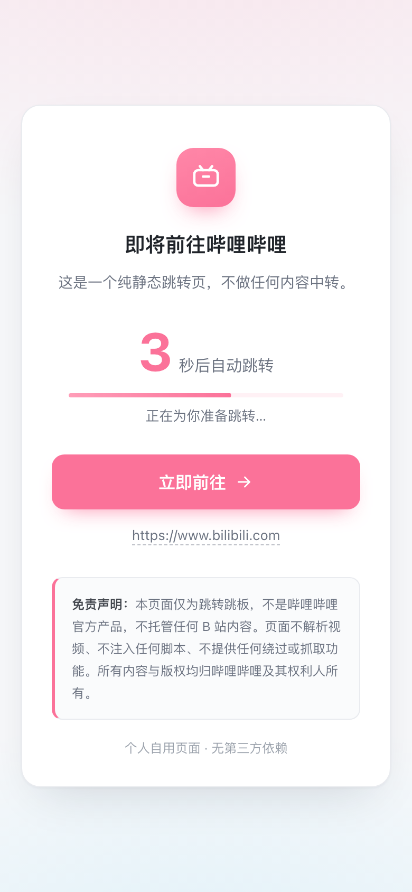

# chrome-bili-jump

一个托管在 GitHub Pages 上的**纯静态跳转跳板页**，个人自用。

打开页面后倒计时 5 秒，自动跳转到 [bilibili.com](https://www.bilibili.com)；同时提供「立即前往」按钮和明文链接作为手动入口，不依赖任何第三方库、后端服务或 iframe。

> 线上地址：<https://adrianandroid.github.io/chrome-bili-jump/>

## 页面预览

| 电脑端（1280 × 800） | 手机端（390 × 844） |
| --- | --- |
|  |  |

两张预览图都是用 Chrome DevTools 设备模拟（`Emulation.setDeviceMetricsOverride`）对本地 `index.html` 直接截的，不是设计稿，也不是后期拼图。

## 功能

- 5 秒倒计时结束后自动跳转，倒计时数字 + 进度条同步变化
- 「立即前往」按钮可直接跳转，另有明文 URL 作为兜底入口
- 手机 / 电脑双端自适应，安全区（刘海屏、手势条）留白
- 页面被切到后台时倒计时**暂停**，回到前台继续，避免「回来就已经跳走了」
- 带完整免责声明
- 单文件，无第三方依赖，无构建步骤

## 文件结构

```
chrome-bili-jump/
├── index.html              # 全部页面：HTML + CSS + JS 都在这一个文件里
├── docs/
│   ├── preview-desktop.png # README 用的电脑端截图
│   └── preview-mobile.png  # README 用的手机端截图
└── README.md
```

## 实现思路

### 1. 为什么是单文件

项目定位是「一个跳转页」，部署目标是 GitHub Pages 的静态托管。既然只此一屏内容，把 CSS 和 JS 内联进 `index.html` 有三个直接好处：

- 只有 1 次 HTTP 请求，首屏没有额外的 CSS/JS 往返，跳转页越快越不打扰；
- 分享、备份、改版都只涉及一个文件，不会出现「改了样式忘了改引用」；
- 不需要任何构建工具链，`git push` 即部署。

代价是可维护性弱于拆分多文件，但对这种体量的页面可以接受。

### 2. 布局：单卡片居中

- `body` 用 flex 居中，`min-height: 100dvh` 而不是 `100vh`，避免手机浏览器工具栏导致的「上下露白」；
- 卡片 `max-width: 460px`，配合 `width: 100%`，宽屏时是一张居中小卡，窄屏时自动铺满可用宽度；
- 内边距用 `padding: max(24px, env(safe-area-inset-*))` 处理刘海屏和底部手势条；
- 字体尺寸用 `clamp()`（如 `clamp(19px, 4.6vw, 22px)`），字号随视口平滑变化，不需要为每个断点写一套 media query；
- 倒计时数字加 `font-variant-numeric: tabular-nums`，数字从 5 变到 4 时宽度不变，不会左右抖动。

### 3. 倒计时逻辑

不是简单地 `setInterval` 每秒减一，而是**基于时间戳计算剩余时间**，用 `requestAnimationFrame` 渲染：

```js
var CONFIG = { target: "https://www.bilibili.com", seconds: 5 };

startedAt = performance.now();
function tick(now) {
  var elapsed = now - startedAt;
  var left = remain - elapsed;
  if (left <= 0) { jump(); return; }
  paint(left);                       // 数字 = ceil(left / 1000)，进度条 = left / total
  rafId = requestAnimationFrame(tick);
}
```

这么做的原因：`setInterval` 在主线程繁忙、后台标签页节流时会产生累计误差，甚至漏跳；用「截止时间 - 当前时间」算剩余量则不会漂移，进度条也能和数字严格同步（`scaleX()` 变换比改 `width` 少触发重排）。

补充细节：

- 跳转用 `location.replace()` 而不是 `location.href`，这样浏览器的「后退」不会又回到跳转页再跳一次；
- `visibilitychange` 里暂停 / 恢复：隐藏时记下剩余量并取消动画帧，重新可见时重新计时起点；
- 跳转加了 `jumping` 标志位，避免重复触发；
- 「立即前往」是 `<a>` 元素而不是 `<button>`，中键新标签打开、复制链接、键盘回车都能正常工作，也更符合语义。

### 4. 视觉

- 主色 `#FB7299` 取自 B 站品牌粉，只作为强调色（图标、数字、按钮），正文仍是深灰，保证对比度；
- 所有颜色收在顶部 `:root` 的 CSS 变量里（`--brand`、`--ink`、`--line`、`--surface`、`--page`），后续换配色只改这几行；
- 背景是两层 `radial-gradient` 叠在浅灰底上，营造一点氛围又不会抢内容；
- 顶部图标是内联 SVG（一个电视机轮廓），不引入图片、不引入第三方图标库；
- 进场用一次 0.6s 的 `translateY + opacity` 动画，并遵守 `prefers-reduced-motion`：系统开了「减弱动态效果」就完全不做动画。

### 5. 免责与合规

页面底部固定一块说明：本页面仅为跳转跳板，不是哔哩哔哩官方产品，不托管任何 B 站内容，不解析视频、不注入脚本、不提供绕过或抓取功能，版权归哔哩哔哩及其权利人所有。

对应地，实现上严格守住几条红线：

- 只用原生 HTML / CSS / JavaScript，没有第三方库或框架；
- 没有 iframe，页面里不存在任何嵌入的 B 站内容；
- 没有任何跨域请求、爬虫、解析、DOM 注入、去广告、会员绕过逻辑；
- 页面里唯一的外链就是 `https://www.bilibili.com`。

## 本地运行

```bash
git clone git@github.com:AdrianAndroid/chrome-bili-jump.git
cd chrome-bili-jump
open index.html          # 直接双击/打开就行，无需起服务
```

想用 `http://` 而非 `file://` 预览：

```bash
python3 -m http.server 8080
# 浏览器打开 http://localhost:8080
```

注意：本地打开时倒计时结束同样会跳到 B 站，调试样式建议在 5 秒内操作，或临时把 `CONFIG.seconds` 调大。

## 部署（GitHub Pages）

仓库是公开的，使用 Pages 的「分支 + 根目录」模式，发布源为 `main` 分支的 `/`，所以只需要 `index.html` 在仓库根目录，无需 CI / Actions。

如果换新仓库要重新配置，在仓库 **Settings → Pages** 里选择：

- Source: `Deploy from a branch`
- Branch: `main`，目录 `/ (root)`
- 保存后等待 1~2 分钟，访问 `https://<用户名>.github.io/<仓库名>/`

<details>
<summary>用命令行（GitHub API）配置 Pages</summary>

```bash
# 需要一枚具备 repo 权限的 token
curl -X POST \
  -H "Authorization: Bearer $GITHUB_TOKEN" \
  -H "Accept: application/vnd.github+json" \
  https://api.github.com/repos/AdrianAndroid/chrome-bili-jump/pages \
  -d '{"source":{"branch":"main","path":"/"}}'

# 查部署状态
curl -H "Authorization: Bearer $GITHUB_TOKEN" \
  https://api.github.com/repos/AdrianAndroid/chrome-bili-jump/pages
```

</details>

## 日常改版流程

```bash
cd chrome-bili-jump
# 改 index.html（比如倒计时秒数、配色、文案）
git add index.html
git commit -m "style: 调整倒计时时长"
git push origin main
```

推送后 Pages 会自动重新构建，通常 30 秒 ~ 2 分钟生效，可强刷（`Cmd + Shift + R`）确认。

## 可调参数

| 想改什么 | 改哪里 |
| --- | --- |
| 倒计时秒数 | `index.html` 脚本里的 `CONFIG.seconds`，以及 `#num` 初始值和 `#sr` 文案里的 5 |
| 跳转目标 | `CONFIG.target`，以及 `<a href>` 两处链接 |
| 主色 | `:root` 里的 `--brand` / `--brand-dark` / `--brand-soft` |
| 卡片宽度 | `.card` 的 `max-width` |
| 文案 | `<h1>`、`.lead`、`.hint`、`.notice` |
